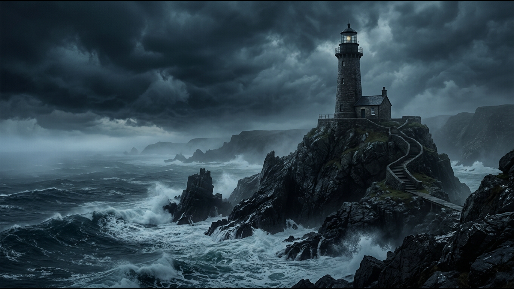

# THE LIGHTHOUSE KEEPER: AFTER THE FALL

> *"Even after the darkest night, the light can return."*



---

## Table of Contents

1. [Project Overview](#project-overview)
2. [Story Overview](#story-overview)
   - [The Setting](#the-setting)
   - [Arthur Hale — The Protagonist](#arthur-hale--the-protagonist)
   - [The First Mystery](#the-first-mystery)
   - [Elias Ward — The Previous Keeper](#elias-ward--the-previous-keeper)
   - [The Impossible Coast](#the-impossible-coast)
   - [The Final Storm](#the-final-storm)
3. [The Core Theme: BOUNCE BACK](#the-core-theme-bounce-back)
   - [A. Arthur's Failure — The Fall](#a-arthurs-failure--the-fall)
   - [B. The Lighthouse — A Symbol of Recovery](#b-the-lighthouse--a-symbol-of-recovery)
   - [C. Elias Ward — What Happens When You Stop Trying](#c-elias-ward--what-happens-when-you-stop-trying)
   - [D. Repeated Attempts — The Meaning of Resilience](#d-repeated-attempts--the-meaning-of-resilience)
   - [E. The Final Decision — Choosing to Rise Again](#e-the-final-decision--choosing-to-rise-again)
   - [F. The Lighthouse Beacon — The Final Metaphor](#f-the-lighthouse-beacon--the-final-metaphor)
4. [Characters](#characters)
5. [Chapters & Narrative Progression](#chapters--narrative-progression)
6. [Choices & Endings](#choices--endings)
7. [Gameplay & Interactive Mechanics](#gameplay--interactive-mechanics)
8. [Visual & Audio Direction](#visual--audio-direction)
9. [Technical Information & Setup](#technical-information--setup)
10. [Credits & Acknowledgements](#credits--acknowledgements)

---

## Project Overview

| Attribute | Specification |
| :--- | :--- |
| **Title** | *The Lighthouse Keeper: After the Fall* |
| **Tagline** | *Even after the darkest night, the light can return.* |
| **Genre** | Psychological Mystery / Atmospheric Horror / Choice-Based Visual Novel |
| **Engine** | Ren'Py 8.5.3 (Python 3.12 stack) |
| **Target Platform** | Desktop (Windows, macOS, Linux) |
| **Playtime** | 20–30 Minutes |
| **Competition Theme** | **BOUNCE BACK** (Hack Club Haven) |

*The Lighthouse Keeper: After the Fall* is an atmospheric narrative visual novel developed for the **Hack Club Haven** theme **BOUNCE BACK**. 

The game follows Arthur Hale, an aspiring maritime engineer who walked away from his career after a catastrophic professional failure. Desperate for a fresh start away from the whispers and shame of his past, he accepts an isolated posting on Tarn Rock—a treacherous North Atlantic outcrop whose lighthouse beacon was extinguished by a hurricane six months ago. 

What begins as an arduous industrial repair assignment rapidly turns into an unsettling psychological mystery involving a missing predecessor, a ghost ship transmitting from beyond the grave, and a tear between realities. Yet beneath its maritime horror framing, the game is fundamentally a meditation on failure, second chances, and the perseverance required to turn the light back on.

---

## Story Overview

### The Setting
The story takes place on **Tarn Rock**, a desolate granite island forty miles off the coast of Newfoundland. Surrounded by boiling black swells, dense sea fog, and jagged reefs, the island has guarded one of the most perilous shipping corridors in the North Atlantic for generations.

Six months ago, a catastrophic gale shattered the lantern glass, stripped the drive gears, and flooded the diesel generator hall, plunging the tower into absolute darkness. Since that night, four commercial freighters have vanished in the quadrant without a single life jacket or oil slick ever washing ashore. The island's longtime keeper, Elias Ward, vanished three weeks ago following repeated unsuccessful attempts to rebuild the machinery. The tower has remained cold and dead ever since.

### Arthur Hale — The Protagonist
Arthur Hale is an observant, introverted engineer in his late twenties. A year prior, Arthur designed an auxiliary marine boiler and pressure-relief system for the cargo vessel *SS Laurentian* in Halifax. Under extreme deadline pressure, he overlooked an erratic spring gauge. During a high-pressure demonstration, the main steam header ruptured, gutting the engine room and badly scalding two stokers.

Though no lives were lost, the disgrace destroyed Arthur's confidence. Convinced that his failure defined him and that any machine he touched was doomed to break, he packed his bags in the middle of the night and abandoned his career. Taking the posting at Tarn Rock is Arthur's desperate attempt to face himself: if he can restore a lighthouse that defeated everyone before him, perhaps his life is not permanently ruined.

### The First Mystery
On his first evening, as a blizzard closes in, the station's disconnected Marconi radio receiver suddenly sparks to life on the decommissioned longwave frequency of 142.80 kHz:

> *"Mayday. Mayday. This is the Evelyn. We are approaching the coast. Can anyone hear us?"*

Upon checking the station's casualty registries, Arthur discovers an impossible truth: the *SS Evelyn*, a twin-screw passenger steamer, foundered in these exact waters thirty-eight years ago in October 1948 with 226 souls aboard. Furthermore, Elias Ward's maintenance logs reveal that Elias had been hearing the exact same transmission on 142.80 kHz before his disappearance. The restoration assignment turns into an investigation of a supernatural phenomenon: the ship does not broadcast across the ocean—it broadcasts from underneath it.

### Elias Ward — The Previous Keeper
Elias Ward spent thirty-two years keeping watch on Tarn Rock. Through handwritten logbooks, audio tapes recorded on a portable reel-to-reel player, and annotated Admiralty charts, Arthur pieces together Ward's final months. 

Initially, Ward approached the repairs with stubborn, professional pride. But after four consecutive generator blowouts and cracked gear castings, frustration gave way to isolation and despair. Elias began believing the sea itself was rejecting his repairs. Ward's story serves as an unsettling mirror to Arthur: a portrait of what happens when a person allows repeated failure to convince them that they are worthless.

### The Impossible Coast
As Arthur cleans the commutators, balances the fuel injectors, and forces the lantern carousel back into motion, the white beam cuts through the fog at 340 degrees north-northwest. 

Where thousands of miles of empty ocean should lie, the light illuminates an impossible, non-Euclidean shoreline: towering basalt cliffs, glowing gaslamps, cobblestone piers, and Victorian tenements rising from a motionless, glassy sea. Emerging from the spectral fog is the black iron hull of the *SS Evelyn*. 

The lighthouse is not merely an illuminator; it is an anchor pinning two realities together. The radio begins addressing Arthur by name, knowing his deepest secrets and offering him an escape from his earthly guilt.

### The Final Storm
When a Force 10 hurricane gale threatens to rip the lantern dome away, Arthur faces the ultimate question that broke Elias Ward:

*When failure seems inevitable, is another attempt still worth making?*

Arthur's choices dictate whether he abandons his post, crosses into the phantom realm, or stands his ground and relights the beacon for the living world.

---

## The Core Theme: BOUNCE BACK

*The Lighthouse Keeper: After the Fall* was designed from the ground up to explore **resilience, recovery, perseverance, and the courage to begin again after catastrophic failure**.

```
       [ THE FALL ]  ──────────────────────────────────────────►  [ THE RETREAT ]
  (Halifax Boiler Rupture)                                       (Isolation on Tarn Rock)
                                                                            │
                                                                            ▼
       [ BOUNCE BACK ] ◄────────────────────────────────────────  [ THE CRUCIBLE ]
  (Restoring the Beacon)                                          (Facing Ward's Ghost)
```

### A. Arthur's Failure — The Fall
Resilience cannot exist without a genuine fall. Arthur is not a flawless video game protagonist; he is a man burdened by real shame, imposter syndrome, and the memory of running away when people needed him most. His failure in Halifax establishes the emotional stakes of the narrative. Every stripped screw and flooded engine block on Tarn Rock reminds him of the boiler rupture, challenging the player to help Arthur confront his trauma rather than flee from it.

### B. The Lighthouse — A Symbol of Recovery
The dark lighthouse is an external manifestation of Arthur's internal state:
- When the beacon is dark, ships crash upon the reefs, symbolizing how Arthur's withdrawal from life left him adrift and helpless.
- The physical labor of restoring the lighthouse—grinding carbon deposits, re-pouring bearings, rewiring circuits—mirrors the slow, unglamorous psychological labor required to rebuild self-worth.
- Recovery is not an instantaneous epiphany; it requires turning one cold bolt at a time.

### C. Elias Ward — What Happens When You Stop Trying
Elias Ward represents the tragic alternative to resilience. When his mechanical repairs failed four times, he stopped viewing the engine as a problem to solve and started viewing himself as a permanent failure. He allowed despair to turn into fatalism, ultimately walking out into the fog to escape the burden of trying again. By studying Ward's notes, Arthur learns that **giving up is the only thing that makes failure permanent**.

### D. Repeated Attempts — The Meaning of Resilience
True resilience is not succeeding on the first attempt; it is having the grit to try a second, third, and fourth time after successive setbacks. In Chapter 1 and Chapter 3, Arthur's initial repair attempts encounter jammed gears, electrical arcing, and freezing blizzards. Progress is achieved through patience, experimentation, and emotional resolve.

### E. The Final Decision — Choosing to Rise Again
During the climax, the radio transmission offers Arthur the ultimate temptation: surrender. The *Evelyn* invites him to cross over into a timeless realm where nobody grows old, nobody suffers, and nobody remembers his failures in Halifax. 

Choosing **Ending A (The Beacon)** requires Arthur to reject the comfort of giving up. He accepts that the living world is messy, difficult, and full of potential mistakes, but chooses to stand on his feet and perform his duty anyway.

### F. The Lighthouse Beacon — The Final Metaphor
The central thesis of the story is captured in Arthur's climactic realization:

> *"The light may go out a thousand times. What matters is whether someone is willing to turn it back on."*

**Bounce Back is not about never falling. It is about what we choose to do after we fall.**

---

## Characters

### Arthur Hale (Protagonist)
* **Age:** 29
* **Role:** Newly appointed keeper of Tarn Rock Lighthouse; former junior maritime engineer.
* **Visuals:** Dark brown tousled hair, tired hazel eyes, wearing a weathered navy wool peacoat. Expressed through six visual novel portraits: `neutral`, `concerned`, `suspicious`, `shocked`, `exhausted`, and `determined`.
* **Personality:** Introverted, analytical, observant, carrying deep-seated guilt from his past, gradually finding his resolve.

### Elias Ward (The Predecessor)
* **Age:** Early 60s
* **Role:** Former lighthouse keeper of Tarn Rock for 32 years (missing).
* **Visuals:** Weathered sea-worn face, unruly silver hair and beard, wearing a heavy knit fisherman's sweater (`neutral`, `serious`, `distressed`).
* **Presence:** Experienced through handwritten journal entries, reel-to-reel magnetic recordings, annotated charts, and apparitions.

### Evelyn's Voice (The Transmission)
* **Identity:** The collective voice transmitting from the phantom passenger liner *SS Evelyn* on 142.80 kHz.
* **Visuals:** Depicted through an analog CRT oscilloscope display with a pulsing green phosphor waveform (`evelyn_signal`).
* **Tone:** Distant, hypnotic, intimate, and unsettlingly calm.

### Mara (Archivist / Coast Guard Relay)
* **Role:** Maritime radio operator stationed at the Cape Race coastal relay station.
* **Function:** Communicates with Arthur over the official emergency quartz channel, providing historical facts about the *Evelyn* disaster and serving as Arthur's sole tether to the outside world.

---

## Chapters & Narrative Progression

The game is structured into five cohesive chapters and an epilogue, all fully written, scripted, and playable in Ren'Py:

```
[PROLOGUE] ────► [CHAPTER 1] ────► [CHAPTER 2] ────► [CHAPTER 3] ────► [CHAPTER 4] ────► [EPILOGUE]
Arrival at       The Fall &        The Keeper        The Impossible    The Last Attempt   3 Reachable
Tarn Rock        First Repairs     Before Him        Coastline         & Final Storm      Endings
```

1. **Prologue — The Arrival (`prologue.rpy`):** Arthur lands on Tarn Rock during a gale, explores the cold quarters, and discovers the extinguished beacon. The dead Marconi radio unexpectedly sparks to life with the *SS Evelyn* distress call.
2. **Chapter 1 — The Fall (`chapter_01.rpy`):** Arthur investigates the damaged generator room, confronts the memory of his past failure in Halifax, and makes the crucial decision to rebuild the power plant rather than flee.
3. **Chapter 2 — The Keeper Before Him (`chapter_02.rpy`):** Arthur examines Elias Ward's private effects—audio reels, photographs, and the chart of the Sunken Reach—discovering how Elias's repeated failures led to his disappearance.
4. **Chapter 3 — The Impossible Coast (`chapter_03.rpy`):** Arthur clears the jammed Fresnel carousel under extreme mechanical load. The revived light cuts through the storm, projecting a phantom Victorian coastline and the towering hull of the *SS Evelyn*.
5. **Chapter 4 — The Last Attempt (`chapter_04.rpy`):** A second storm of hurricane intensity strikes the island. Arthur uncovers Ward's final suicide note and must decide whether to give in to despair or make his final stand.
6. **Epilogue / Chapter 5 — After the Fall (`endings.rpy`):** The story branches into three distinct, fully voiced/soundscaped resolutions based on the player's choices.

---

## Choices & Endings

The game features **eight meaningful decision points** that modify Arthur's core psychological variables:
- `determination` (Perseverance & resilience)
- `curiosity` (Desire to uncover hidden lore)
- `trust_in_signal` (Vulnerability to the phantom voice)
- `lighthouse_condition` (Physical state of the machinery)
- `knowledge_of_evelyn` (Understanding of the 1948 disaster)

### The Three Endings

```
                           ┌──► [ENDING A: THE BEACON]   (Hope, resilience, duty)
[CLIMACTIC CHOICE (CH. 4)] ┼──► [ENDING B: THE CROSSING] (Escape into the unknown)
                           └──► [ENDING C: THE KEEPER]   (Endless solitary vigil)
```

#### 1. Ending A: THE BEACON (The Bounce Back Ending)
* **Conditions:** Arthur commits to duty, resets the mechanical governor, and engages the 15-second radial sweep.
* **Outcome:** The dispersed beam stops anchoring the supernatural seam. The *Evelyn* bids Arthur a peaceful farewell and dissolves into the sea spray. Dawn arrives in radiant gold and steel-blue; a coastal freighter spots the light and skirts the reef safely. Arthur accepts his role as keeper, having conquered his fear of failure.
* **Atmosphere:** Hopeful, triumphant, and bittersweet.

#### 2. Ending B: THE CROSSING
* **Conditions:** Arthur locks the beam at 340° NNW, pointing directly at the phantom city.
* **Outcome:** The ocean freezes into black obsidian glass. Leaving his service badge on the desk, Arthur walks across the water and boards the *Evelyn* alongside Elias Ward, sailing past the edge of the world.
* **Atmosphere:** Ethereal, haunting, and ambiguous.

#### 3. Ending C: THE KEEPER
* **Conditions:** Arthur cuts the kerosene fuel valve, refusing either to destroy the ship or abandon the station.
* **Outcome:** The light dies, leaving the boundary in equilibrium. Arthur dons the headphones and sits at the radio in perpetual vigil. Decades pass without aging, waiting for the cycle to renew with the next fallen keeper.
* **Atmosphere:** Somber, cyclical, and deeply psychological.

---

## Gameplay & Interactive Mechanics

- **Choice & Consequence Engine:** Player decisions directly alter dialogue, internal monologue, repair success, and ending availability.
- **Environmental Storytelling:** Inspectable logbooks, hand-drawn nautical charts, audio recordings, and maintenance schematics provide non-linear worldbuilding.
- **Dynamic Character Expressions:** Arthur's character art shifts dynamically between six distinct emotional states (`neutral`, `concerned`, `suspicious`, `shocked`, `exhausted`, `determined`) reflecting his mental resilience.
- **Audio-Visual Radio Interface:** Radio interactions feature customized oscilloscopes and CRT scanline effects synced with vintage audio filters.
- **Full Ren'Py Quality-of-Life:** Complete save/load system, backlog history, dialogue skipping, auto-forward mode, and configurable audio mixers.

---

## Visual & Audio Direction

### Visual Palette
* **Colors:** Deep navy (`#060b11`), slate grey (`#4f6272`), muted sea green (`#102d24`), warm amber (`#f2bc6a`), and pale moonlight (`#c4d5e2`).
* **Artwork:** 14 high-resolution 16:9 cinematic backgrounds (1920×1080) and 10 custom character portraits.
* **Atmosphere:** Heavy rain, salt spray, iron masonry, glowing vacuum tubes, and dramatic chiaroscuro lighting.

### Audio Design
All audio files are custom-engineered, uncompressed 16-bit PCM WAV tracks tailored for maximum spatial immersion:
* **Musical Themes (`game/audio/music/`):**
  * `menu_theme.wav`: Melancholic D-minor ambient drone with gentle glassy chimes.
  * `exploration_theme.wav`: Eerie F#-minor suspense drone with subtle metallic transients.
  * `mystery_theme.wav`: Detuned heterodyne oscillators and ghostly harmonics.
  * `decision_theme.wav`: Tense 60-BPM heartbeat pulse with swelling dark strings.
  * `ending_theme.wav`: Bittersweet, oceanic resolution chords.
* **SFX & Ambience (`game/audio/sfx/`, `game/audio/ambience/`):**
  * Layered ocean swells, howling gale gusts, rolling thunder, iron door latches, footfalls on oak floorboards, rotary machinery hums, switch clicks, radio tuning whistles, and the mournful dual-tone foghorn.

---

## Technical Information & Setup

### Project Layout
```
OneMoreTry/
├── README.md                   # Project documentation
├── log.txt                     # Ren'Py execution log
└── game/
    ├── script.rpy              # Game entry point and initialization
    ├── characters.rpy          # Character, audio channel, and transform definitions
    ├── variables.rpy           # Global story variables and state tracker
    ├── options.rpy             # Engine configuration, window titles, versioning
    ├── screens.rpy             # Custom UI screens, main menu, navigation
    ├── gui.rpy                 # Color schemes, fonts, spacing
    ├── story/                  # Narrative chapter scripts
    │   ├── prologue.rpy        # Prologue: The Arrival
    │   ├── chapter_01.rpy      # Chapter 1: The Fall
    │   ├── chapter_02.rpy      # Chapter 2: The Keeper Before Him
    │   ├── chapter_03.rpy      # Chapter 3: The Impossible Coast
    │   ├── chapter_04.rpy      # Chapter 4: The Last Attempt
    │   └── endings.rpy         # Chapter 5: Three Endings
    ├── images/
    │   ├── backgrounds/        # 14 1080p environment backgrounds
    │   └── characters/         # Transparent PNG character portraits
    └── audio/
        ├── music/              # Ambient soundtrack compositions
        ├── sfx/                # Sound effects
        └── ambience/           # Looping background ambiances
```

### How to Run the Game

1. **Prerequisites:**
   Download and install the [Ren'Py 8.5.3 SDK](https://www.renpy.org/release/8.5.3) for your operating system.

2. **Add Project to Launcher:**
   * Open the Ren'Py Launcher.
   * Click **preferences** > **Projects Directory** and ensure the folder containing `OneMoreTry` is selected (or place `OneMoreTry` in your existing projects directory).
   * `The Lighthouse Keeper: After the Fall` will appear in your project list.

3. **Launch the Game:**
   * Select the project in the launcher.
   * Click **Launch Project** on the bottom right.

4. **Verify / Lint (Optional):**
   * To verify script integrity, select **Lint** under Actions in the Ren'Py Launcher.
   * The project compiles cleanly with **0 errors and 0 warnings**.

---

## Credits & Acknowledgements

* **Game Concept & Writing:** Developed for Hack Club Haven (Theme: *Bounce Back*).
* **Game Engine:** [Ren'Py Visual Novel Engine](https://www.renpy.org/) (Version 8.5.3) by PyTom and contributors.
* **Art Direction & UI Design:** Developed for *The Lighthouse Keeper* project.
* **Audio Engineering:** Custom synthesized soundscapes and ambient compositions generated in 16-bit PCM stereo.
* **Special Thanks:** The Hack Club community, maritime history archivists, and everyone who has ever had to pick themselves up after a fall.

---

> *"The light may go out a thousand times. What matters is whether someone is willing to turn it back on."*
